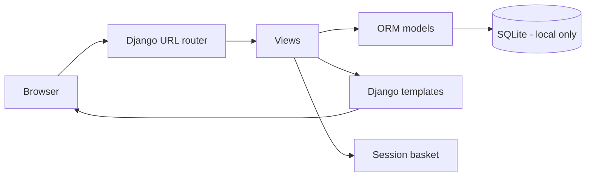

# Architecture and proof-of-concept boundaries

## Django Model–View–Template

- **Model** (`shop/models.py`): Category has many Products. Order has many OrderItems. An OrderItem preserves the product name and price at the point of checkout. Products have controlled prices and stock counts.
- **View** (`shop/views.py`): endpoint request handlers query models and assemble page contexts. Basket manipulation is only permitted with POST. `demo_checkout` validates the order form, reads authoritative prices, checks available inventory and writes an order in a database transaction.
- **Template** (`shop/templates/shop/`): Django server-side rendering, with a reusable base layout and product cards; `shop/static/` contains CSS and original graphics.
- **Persistence**: SQLite is sufficient for a local, single-user proof of concept, not a durable multi-instance production architecture.

## Request flow

## Proposed DevOps next phase (not yet implemented)

## Practical, honest limitations to discuss in the report

- MVT provides modularity, but it does **not** automatically remove monolithic scaling limits or eliminate downtime.
- SQLite, development server and unconfigured deployment credentials are not production ready.
- Basket uses sessions, so portability across multiple instances requires shared, correctly configured session persistence.
- Test suite covers key routes and business logic but does not yet include browser-driven end-to-end testing.
- Monitoring endpoint can prove server reachability but not checkout correctness; realistic monitoring will need external checks and incident handling.
- No real payment provider or authentication flow is implemented, by design.
